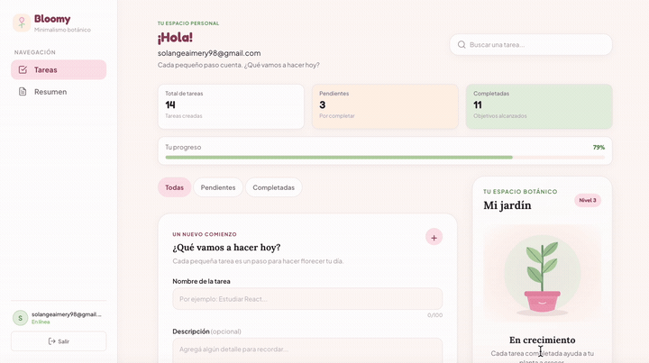

🌸 Bloomy

Make your days bloom.

Bloomy es una aplicación web de gestión de tareas que combina productividad y gamificación. Permite organizar actividades, realizar un seguimiento del progreso personal y cultivar un jardín virtual que crece a medida que se completan objetivos.

Cada pequeña tarea es un paso para hacer florecer tu día. 🌱

<p align="center">
  <a href="https://task-manager-delta-sandy.vercel.app/">
    <strong>🌷 VISITAR BLOOMY</strong>
  </a>
</p>

⸻

🌷 Demostración

Envío de resumen de productividad por email

Bloomy permite generar y enviar un resumen de productividad mediante una API serverless integrada con AWS Simple Email Service (SES).

<p align="center">
  
</p>

⸻

✨ Funcionalidades principales

🔐 Autenticación

* Registro de usuarios.
* Inicio y cierre de sesión.
* Autenticación mediante Firebase Authentication.
* Persistencia de sesión.
* Protección de rutas privadas y públicas.
* Manejo de errores de autenticación.

📝 Gestión de tareas

* Crear nuevas tareas.
* Editar tareas existentes.
* Eliminar tareas.
* Marcar tareas como completadas o pendientes.
* Búsqueda de tareas.
* Filtrado por estado.
* Sincronización en tiempo real mediante Cloud Firestore.
* Persistencia de información por usuario.

🌱 Jardín virtual y gamificación

Bloomy incorpora un sistema de progresión que transforma las tareas completadas en puntos de crecimiento.

* Cada tarea completada por primera vez otorga 10 puntos.
* Los puntos se acumulan para desbloquear nuevos niveles.
* El progreso del jardín se conserva entre sesiones.
* Una tarea que ya otorgó puntos no vuelve a recompensarse al completarla nuevamente.
* La finalización de tareas y la acreditación de recompensas se realizan mediante una transacción de Firestore.

El jardín cuenta con cinco niveles de crecimiento:

Nivel	Puntos necesarios	Etapa
1	0	Brote
2	50	Primeras hojas
3	100	Crecimiento
4	200	Floración
5	350	Plena floración

📊 Resumen de productividad

La sección de resumen permite visualizar:

* Total de tareas creadas.
* Tareas pendientes.
* Tareas completadas.
* Progreso general.
* Actividad semanal.
* Nivel y progreso del jardín.

📧 Envío de resumen por email

La aplicación permite solicitar el envío de un resumen de productividad mediante una función serverless.

El flujo de funcionamiento incluye:

1. Autenticación del usuario mediante Firebase Authentication.
2. Envío del token de acceso al backend.
3. Verificación del token mediante Firebase Admin SDK.
4. Consulta de las tareas y los datos del jardín del usuario en Firestore.
5. Generación de estadísticas y actividad semanal.
6. Construcción del contenido HTML y texto del correo.
7. Envío mediante AWS SES.

La integración está desplegada y probada en producción utilizando el entorno sandbox de AWS SES.

⸻

🛠️ Tecnologías utilizadas

Frontend

* React 18
* TypeScript
* Vite
* React Router DOM 6
* CSS3

Backend y servicios

* Firebase Authentication
* Cloud Firestore
* Firebase Admin SDK
* Vercel Serverless Functions
* AWS Simple Email Service (SES)
* AWS SDK for JavaScript v3

Testing

* Vitest
* React Testing Library
* Jest DOM
* User Event
* jsdom
* Firebase Rules Unit Testing

Herramientas

* Git
* GitHub
* Vercel
* Firebase Emulator Suite
* Visual Studio Code
* Antigravity

⸻

## 🏗️ Arquitectura del proyecto

El proyecto utiliza una arquitectura organizada por funcionalidades y responsabilidades, separando la interfaz visual, la lógica de negocio, los servicios y la configuración.

### Estructura de carpetas

```text
task-manager/
├── api/
│   ├── lib/
│   │   └── firebaseAdmin.ts
│   └── send-summary.ts
├── docs/
│   ├── evidencias/
│   │   └── demo-envio-email.gif
│   └── ia/
│       └── README.md
├── public/
│   └── favicon.svg
├── src/
│   ├── components/
│   │   ├── dashboard/
│   │   ├── garden/
│   │   └── layout/
│   ├── features/
│   │   ├── auth/
│   │   ├── garden/
│   │   └── tasks/
│   ├── hooks/
│   ├── pages/
│   ├── routes/
│   ├── services/
│   │   └── firebase/
│   ├── styles/
│   ├── types/
│   ├── utils/
│   ├── App.tsx
│   ├── index.css
│   └── main.tsx
├── tests/
│   ├── api/
│   ├── features/
│   ├── security/
│   └── ...
├── firestore.rules
├── index.html
├── package.json
├── package-lock.json
├── tsconfig.json
├── vercel.json
└── README.md
```

### Organización de responsabilidades

| Directorio | Responsabilidad |
|---|---|
| `components/` | Componentes reutilizables de interfaz. |
| `features/` | Lógica y servicios organizados por funcionalidad. |
| `hooks/` | Hooks personalizados de React. |
| `pages/` | Páginas principales de la aplicación. |
| `routes/` | Configuración de navegación y rutas. |
| `services/` | Integración con servicios externos. |
| `styles/` | Estilos y sistema visual. |
| `types/` | Interfaces y definiciones de TypeScript. |
| `utils/` | Funciones auxiliares. |
| `api/` | Endpoints serverless y servicios administrativos. |
| `tests/` | Pruebas unitarias, de componentes, API y seguridad. |
🚀 Instalación y ejecución local

⸻

Requisitos previos

* Node.js.
* npm.
* Una cuenta de Firebase.
* Una cuenta de AWS para configurar SES.

1. Clonar el repositorio

git clone https://github.com/solangeAimery98/proyectoM4SolangeAimery.git

2. Ingresar al proyecto

cd proyectoM4SolangeAimery

3. Instalar dependencias

npm install

4. Configurar variables de entorno

Crear un archivo .env en la raíz del proyecto.

Variables necesarias para Firebase en el frontend:

VITE_FIREBASE_API_KEY=
VITE_FIREBASE_AUTH_DOMAIN=
VITE_FIREBASE_PROJECT_ID=
VITE_FIREBASE_STORAGE_BUCKET=
VITE_FIREBASE_MESSAGING_SENDER_ID=
VITE_FIREBASE_APP_ID=

Variables necesarias para Firebase Admin y AWS SES en el backend:

FIREBASE_PROJECT_ID=
FIREBASE_CLIENT_EMAIL=
FIREBASE_PRIVATE_KEY=
AWS_ACCESS_KEY_ID=
AWS_SECRET_ACCESS_KEY=
AWS_REGION=
SES_FROM_EMAIL=

Importante: las credenciales privadas deben mantenerse protegidas. No deben publicarse en GitHub ni incluirse en el código del frontend.

5. Ejecutar en desarrollo

npm run dev

Vite proporcionará la dirección local para acceder a la aplicación.

⸻

🧪 Testing

El proyecto incorpora pruebas para verificar el funcionamiento de sus principales funcionalidades y la seguridad de los datos.

Tests principales

npm run test:run

Tests de seguridad de Firestore

Primero, iniciar el emulador:

npx firebase emulators:start --only firestore

En otra terminal, ejecutar:

npm run test:security

Tests del sistema de jardín

npm run test:garden

Ejecutar todas las suites

npm run test:all

El comando ejecuta las suites principales, de seguridad y del sistema de jardín. Para la suite de seguridad debe estar disponible el emulador de Firestore.

⸻

🔒 Seguridad

Bloomy incorpora mecanismos de seguridad tanto en el frontend como en el backend.

Entre ellos:

* Autenticación mediante Firebase Authentication.
* Protección de rutas privadas.
* Verificación de tokens de autenticación en el backend.
* Aislamiento de datos mediante el identificador único de usuario.
* Reglas de seguridad personalizadas para Firestore.
* Validación de datos y campos permitidos.
* Control de operaciones sobre tareas y recompensas.
* Uso de variables de entorno para proteger credenciales privadas.

Las reglas de Firestore restringen el acceso a los datos y validan las operaciones permitidas para cada usuario.

⸻

☁️ Deploy y servicios en producción

La aplicación está desplegada en Vercel.

Servicios utilizados:

Servicio	Función
Vercel	Hosting y funciones serverless.
Firebase Authentication	Gestión de usuarios y autenticación.
Cloud Firestore	Persistencia y sincronización de datos.
AWS SES	Envío de resúmenes por correo electrónico.

Las variables de entorno se configuran en Vercel para mantener separadas las credenciales públicas del frontend y las credenciales privadas del backend.

Aplicación: Bloomy — Producción

⸻

🤖 Uso de inteligencia artificial

Durante el desarrollo se utilizaron herramientas de inteligencia artificial como apoyo en distintas etapas del proyecto.

Su utilización incluyó asistencia en:

* Planificación y arquitectura.
* Implementación de funcionalidades.
* Diseño y organización de componentes.
* Revisión y debugging.
* Testing.
* Documentación técnica.

Las herramientas utilizadas incluyeron ChatGPT, Claude Code y Antigravity.

La documentación detallada sobre las herramientas utilizadas, sus intervenciones y las evidencias del proceso se encuentra en:

[Consultar documentación de uso de IA](docs/ia/README.md)

⸻

🎨 Identidad visual

Bloomy utiliza una identidad visual inspirada en el minimalismo botánico.

Su diseño busca transmitir calma, crecimiento y organización mediante:

* Una paleta de colores pastel.
* Tonos rosa, crema y verde salvia.
* Tipografías que combinan elegancia y modernidad.
* Detalles botánicos.
* Componentes visuales minimalistas.
* Diseño responsive para dispositivos móviles y escritorio.

La experiencia está pensada para ofrecer una interfaz clara, agradable y funcional.

⸻

👩‍💻 Autora

Solange Aimery

Proyecto desarrollado como parte del Proyecto Integrador 4 de Henry.

⸻

<p align="center">
  🌸 <strong>Bloomy — Make your days bloom.</strong> 🌸
</p>